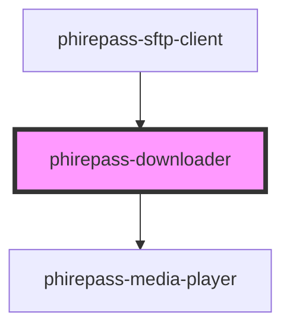

# phirepass-downloader

<!-- Auto Generated Below -->

## Overview

Remote Fetch: paste a link or a magnet, or drop a `.torrent`, and the node
downloads it into its own download folder.

Two forms, one component. **Embedded** in the SFTP browser (`compact`), it
shares the host's channel, which forwards it the `Download*` frames through
`receive()`, and saves into the folder on screen when the node can map it.
**Standalone**, it builds its own channel, signs in with `token`, and saves
into the download folder or a sub-folder of it. Either way it never asks for
a login: the node writes its own files.

The widget only sends events and shows progress. Downloads run on the node
and carry on after the tab closes.

## Properties

| Property              | Attribute            | Description                                                                                                                                                                                                                                                      | Type                                                                                                                                                                                                                                                                                        | Default           |
| --------------------- | -------------------- | ---------------------------------------------------------------------------------------------------------------------------------------------------------------------------------------------------------------------------------------------------------------- | ------------------------------------------------------------------------------------------------------------------------------------------------------------------------------------------------------------------------------------------------------------------------------------------- | ----------------- |
| `allowInsecure`       | `allow-insecure`     |                                                                                                                                                                                                                                                                  | `boolean`                                                                                                                                                                                                                                                                                   | `false`           |
| `browsingPath`        | `browsing-path`      | The folder on screen in the host. Downloads land here when it lies inside the download folder.                                                                                                                                                                   | `string`                                                                                                                                                                                                                                                                                    | `undefined`       |
| `browsingService`     | `browsing-service`   | The SFTP/SSH service the host is browsing, so the node can map `browsingPath`.                                                                                                                                                                                   | `string`                                                                                                                                                                                                                                                                                    | `undefined`       |
| `canConfigure`        | `can-configure`      | Whether the viewer may configure this node, which only changes advice text (B9).                                                                                                                                                                                 | `boolean`                                                                                                                                                                                                                                                                                   | `false`           |
| `channel`             | --                   | A channel to share instead of opening one: the SFTP client passes its own. The host must forward `Download*` frames (and `Error`s whose `msg_id` is at or above `DOWNLOADER_MSG_ID_BASE`) to `receive()`, and set `connected` once the channel is authenticated. | `Pick<ChannelLike, "connect" \| "disconnect" \| "is_connected" \| "authenticate" \| "start_heartbeat" \| "stop_heartbeat" \| "on_connection_open" \| "on_connection_close" \| "on_connection_error" \| "on_connection_message" \| "on_protocol_message"> & Partial<DownloadChannelMethods>` | `undefined`       |
| `channelFactory`      | --                   | Builds the channel in place of a WebSocket, for demos and tests (see `ChannelFactory`).                                                                                                                                                                          | `(endpoint: string, nodeId: string, serverId?: string) => DownloadChannelLike`                                                                                                                                                                                                              | `undefined`       |
| `compact`             | `compact`            | The drawer layout used inside the SFTP browser.                                                                                                                                                                                                                  | `boolean`                                                                                                                                                                                                                                                                                   | `false`           |
| `connected`           | `connected`          | With an injected `channel`: whether it is authenticated and usable.                                                                                                                                                                                              | `boolean`                                                                                                                                                                                                                                                                                   | `false`           |
| `heartbeatInterval`   | `heartbeat-interval` |                                                                                                                                                                                                                                                                  | `number`                                                                                                                                                                                                                                                                                    | `30_000`          |
| `inlinePlayer`        | `inline-player`      | Open the built-in player on Play, unless a `phirepassPlay` listener calls `preventDefault()`.                                                                                                                                                                    | `boolean`                                                                                                                                                                                                                                                                                   | `true`            |
| `nodeId` _(required)_ | `node-id`            |                                                                                                                                                                                                                                                                  | `string`                                                                                                                                                                                                                                                                                    | `undefined`       |
| `nodeLabel`           | `node-label`         | What to call the node in sentences; the id is a uuid nobody reads.                                                                                                                                                                                               | `string`                                                                                                                                                                                                                                                                                    | `undefined`       |
| `serverHost`          | `server-host`        |                                                                                                                                                                                                                                                                  | `string`                                                                                                                                                                                                                                                                                    | `'phirepass.com'` |
| `serverId`            | `server-id`          |                                                                                                                                                                                                                                                                  | `string`                                                                                                                                                                                                                                                                                    | `undefined`       |
| `serverPort`          | `server-port`        |                                                                                                                                                                                                                                                                  | `number`                                                                                                                                                                                                                                                                                    | `443`             |
| `streamBase`          | `stream-base`        | Base URL for `/api/web/stream/…`. Defaults to the server the channel talks to.                                                                                                                                                                                   | `string`                                                                                                                                                                                                                                                                                    | `undefined`       |
| `token`               | `token`              | Session token, for the standalone form. Not needed when `channel` is given.                                                                                                                                                                                      | `string`                                                                                                                                                                                                                                                                                    | `undefined`       |

## Events

| Event                       | Description                                                                                    | Type                                                                                      |
| --------------------------- | ---------------------------------------------------------------------------------------------- | ----------------------------------------------------------------------------------------- |
| `phirepassActiveCount`      | How many downloads are running, for a badge.                                                   | `CustomEvent<{ n: number; }>`                                                             |
| `phirepassFetchCompleted`   | A finished download, once per job. The SFTP client refreshes when it lands in the open folder. | `CustomEvent<{ download_id: string; dest_root: string; sub_dir: string; name: string; }>` |
| `phirepassOpenNodeSettings` | “Open node settings” (B9, no folder).                                                          | `CustomEvent<{ nodeId: string; }>`                                                        |
| `phirepassPlay`             | Play was pressed. Cancelable: prevent it to open your own player instead.                      | `CustomEvent<{ src: string; name: string; downloadId: string; }>`                         |
| `phirepassShowInFolder`     | “Show in folder” on a finished row.                                                            | `CustomEvent<{ path: string; name: string; }>`                                            |
| `phirepassSignIn`           | “Sign in” (X3).                                                                                | `CustomEvent<void>`                                                                       |

## Methods

### `deleteDownload(downloadId: string, deleteFile?: boolean) => Promise<void>`

Deletes a download (an unfinished one always loses its part file).

#### Parameters

| Name         | Type      | Description |
| ------------ | --------- | ----------- |
| `downloadId` | `string`  |             |
| `deleteFile` | `boolean` |             |

#### Returns

Type: `Promise<void>`

### `jobForPath(path: string) => Promise<{ download_id: string; name: string; } | null>`

The running download whose part file this is, so the SFTP client can offer K3 instead of a plain delete.

#### Parameters

| Name   | Type     | Description |
| ------ | -------- | ----------- |
| `path` | `string` |             |

#### Returns

Type: `Promise<{ download_id: string; name: string; }>`

### `openFetch(path?: string) => Promise<void>`

Opens the Fetch dialog (and the drawer behind it). `path` updates the folder on screen.

#### Parameters

| Name   | Type     | Description |
| ------ | -------- | ----------- |
| `path` | `string` |             |

#### Returns

Type: `Promise<void>`

### `receive(msg: ProtocolMessage | { data: { web: unknown; }; }) => Promise<void>`

Hands this widget a frame from a shared channel: `Download*` frames, and
`Error`s answering one of its `msg_id`s. Anything else is ignored.

#### Parameters

| Name  | Type                                              | Description |
| ----- | ------------------------------------------------- | ----------- |
| `msg` | `ProtocolMessage \| { data: { web: unknown; }; }` |             |

#### Returns

Type: `Promise<void>`

### `startTorrentPath(path: string, inOrder?: boolean) => Promise<boolean>`

C: download the contents of a `.torrent` already on the node, into the folder it sits in.

#### Parameters

| Name      | Type      | Description |
| --------- | --------- | ----------- |
| `path`    | `string`  |             |
| `inOrder` | `boolean` |             |

#### Returns

Type: `Promise<boolean>`

### `toggleDrawer(open?: boolean) => Promise<void>`

Opens or closes the drawer (embedded).

#### Parameters

| Name   | Type      | Description |
| ------ | --------- | ----------- |
| `open` | `boolean` |             |

#### Returns

Type: `Promise<void>`

### `torrentPathFor(path: string) => Promise<string | null>`

The path of a `.torrent` on the node relative to the download folder, or
null when it lies outside it (then C's menu item is not offered).

#### Parameters

| Name   | Type     | Description |
| ------ | -------- | ----------- |
| `path` | `string` |             |

#### Returns

Type: `Promise<string>`

## Dependencies

### Used by

 - [phirepass-sftp-client](../phirepass-sftp-client)

### Depends on

- [phirepass-media-player](../phirepass-media-player)

### Graph

----------------------------------------------

*Built with [StencilJS](https://stenciljs.com/)*
