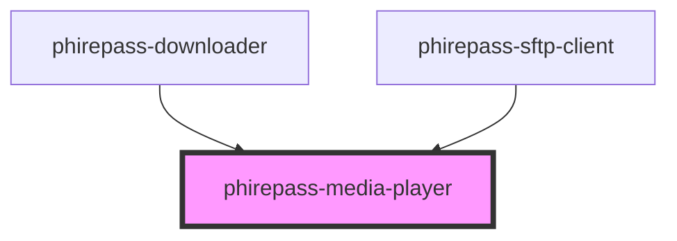

# phirepass-media-player

<!-- Auto Generated Below -->

## Overview

Plays a file from the node with the browser's own `<video>` or `<audio>`.

It knows nothing of channels or WASM: `src` is a stream URL the server turns
into stream events towards the agent, and the browser's range requests do
the rest. A download that is still arriving plays as far as `ready` bytes;
past that the element waits, and so does the player, saying why.

## Properties

| Property            | Attribute      | Description                                                                            | Type                                                                                                                                                                                                                                                                                                                                                                                                 | Default     |
| ------------------- | -------------- | -------------------------------------------------------------------------------------- | ---------------------------------------------------------------------------------------------------------------------------------------------------------------------------------------------------------------------------------------------------------------------------------------------------------------------------------------------------------------------------------------------------- | ----------- |
| `castDevice`        | `cast-device`  | Shown while casting, when the host knows the device's name.                            | `string`                                                                                                                                                                                                                                                                                                                                                                                             | `undefined` |
| `mime`              | `mime`         | Overrides the mime the extension implies.                                              | `string`                                                                                                                                                                                                                                                                                                                                                                                             | `undefined` |
| `name` _(required)_ | `name`         |                                                                                        | `string`                                                                                                                                                                                                                                                                                                                                                                                             | `undefined` |
| `positionKey`       | `position-key` | Key for the stored position: `dl:<download_id>:<file>` or `node:<node_id>:<path>`.     | `string`                                                                                                                                                                                                                                                                                                                                                                                             | `undefined` |
| `positionStore`     | --             | “Continue watching”. Without one, positions stay in this browser.                      | `{ get(key: string): Promise<StoredPosition>; set(key: string, secs: number, duration: number): Promise<void>; clear?(key: string): Promise<void>; }`                                                                                                                                                                                                                                                | `undefined` |
| `ready`             | `ready`        | Bytes ready from the start of the file, while it is still downloading.                 | `number`                                                                                                                                                                                                                                                                                                                                                                                             | `undefined` |
| `remotePlayback`    | --             | Stands in for `video.remote`, for demos and tests (like `channelFactory`).             | `{ state: "connected" \| "disconnected" \| "connecting"; watchAvailability(cb: (available: boolean) => void): Promise<number>; cancelWatchAvailability(id?: number): Promise<void>; prompt(): Promise<void>; addEventListener(type: "connect" \| "disconnect" \| "connecting", cb: () => void): void; removeEventListener(type: "connect" \| "disconnect" \| "connecting", cb: () => void): void; }` | `undefined` |
| `src` _(required)_  | `src`          | The stream URL: `/api/web/stream/{node}/{download}/{file}` or a listing token URL.     | `string`                                                                                                                                                                                                                                                                                                                                                                                             | `undefined` |
| `status`            | `status`       | The status line above the picture, from the job: “Downloading · 23.4%”, “On the node”. | `string`                                                                                                                                                                                                                                                                                                                                                                                             | `undefined` |

## Events

| Event                  | Description | Type                |
| ---------------------- | ----------- | ------------------- |
| `phirepassPlayerClose` |             | `CustomEvent<void>` |

## Methods

### `close() => Promise<void>`

Closes the player, saving where it stopped. The download is not affected.

#### Returns

Type: `Promise<void>`

## Dependencies

### Used by

 - [phirepass-downloader](../phirepass-downloader)
 - [phirepass-sftp-client](../phirepass-sftp-client)

### Graph

----------------------------------------------

*Built with [StencilJS](https://stenciljs.com/)*
